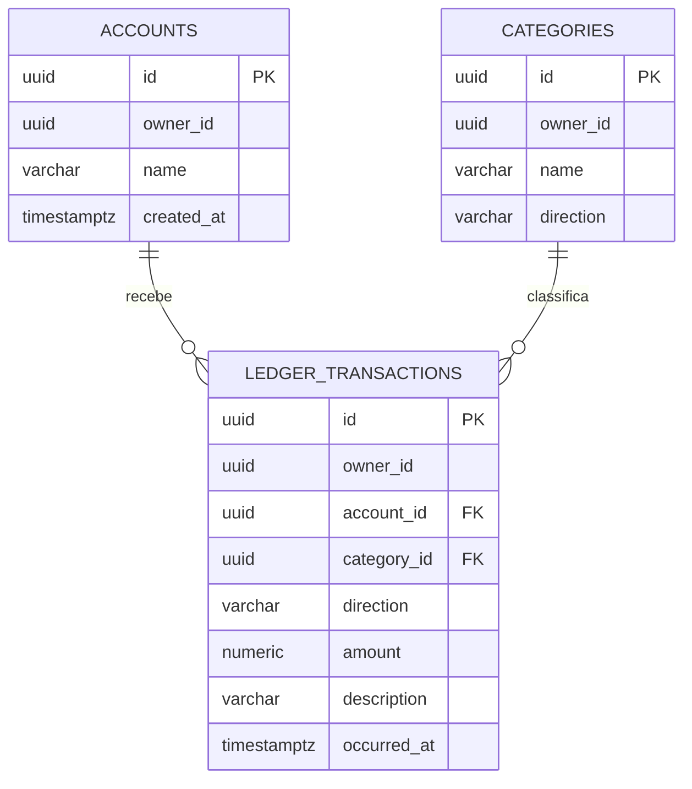

# Explicação do projeto: finanças pessoais

Este é meu registro do que implementei na API de finanças pessoais e das escolhas que fiz para estudar backend e banco de dados. Eu deixei os exemplos de chamadas em docs/API.md e a estrutura do banco em uma migração Flyway.

## O que eu implementei

Implementei uma API para criar contas, categorias e lançamentos, além de consultar movimentações e totais mensais. Usei Spring JDBC para manter o SQL visível no código. Consegui compilar o projeto; ainda não rodei a aplicação integrada a um PostgreSQL neste ambiente.

## Como organizei os arquivos

```text
01-financas-pessoais/
├── docs/
│   ├── API.md
│   └── GUIA_DE_ESTUDO.md
├── src/main/java/br/com/portfolio/financas/
│   ├── FinancasApplication.java
│   ├── FinanceController.java
│   ├── FinanceDtos.java
│   ├── FinanceService.java
│   └── ApiExceptionHandler.java
├── src/main/resources/
│   ├── application.properties
│   └── db/migration/V1__schema_inicial.sql
├── compose.yaml
├── pom.xml
└── README.md
```

Eu separei as responsabilidades: o controller recebe HTTP, os DTOs definem os dados aceitos e devolvidos, o serviço aplica as regras e executa SQL, e a migração descreve a estrutura persistida.

## Modelo de dados que escolhi



Eu mantive três tabelas principais. Uma transação pertence a uma conta e a uma categoria. Também gravei owner_id nas tabelas relacionadas e usei chaves estrangeiras compostas para o PostgreSQL impedir relações entre dados de proprietários diferentes.

## Como uma transação percorre a aplicação

1. O cliente envia X-Owner-Id e os campos da transação.
2. Bean Validation verifica campos obrigatórios, tamanho de texto e valor monetário.
3. FinanceController encaminha a solicitação para FinanceService.
4. O serviço confirma que a conta e a categoria pertencem ao owner_id informado.
5. O serviço compara a direção da categoria com a direção da transação.
6. Só então o INSERT grava o lançamento; as chaves e os CHECKs do banco validam novamente as relações e o valor.

Eu não atualizo um saldo armazenado em paralelo. O saldo mensal é calculado somando o histórico; assim evito manter duas cópias do mesmo fato financeiro.

## Por que usei esses tipos e consultas

Para dinheiro, usei BigDecimal em Java e NUMERIC(14,2) no PostgreSQL. Evitei double porque ele pode representar frações decimais com aproximação binária. Neste MVP, todos os valores são tratados como reais (BRL).

Para datas, gravei TIMESTAMPTZ e calculei os meses em UTC. O resumo mensal soma receitas e despesas com SUM e FILTER, usa COALESCE quando não há lançamentos e agrupa despesas por categoria. O intervalo começa no primeiro instante do mês e termina antes do mês seguinte.

Criei índices começando por owner_id, pois minhas consultas filtram os registros do proprietário antes de ordenar ou agrupar. Ainda preciso comparar planos com EXPLAIN ANALYZE quando puder executar um banco local.

## Limites que deixei registrados

X-Owner-Id serve para separar dados de demonstração, mas não autentica quem faz a requisição. Uma pessoa pode tentar enviar outro UUID. Por isso, eu mantenho este projeto para execução local e não uso dados financeiros reais.

Também não implementei login, autorização real, edição ou exclusão de lançamentos, recorrência, orçamento ou conversão de moedas.

## Próximos passos que anotei

- Implementar autenticação e derivar o proprietário da identidade validada, em vez de confiar no cabeçalho.
- Criar orçamento mensal por categoria.
- Avaliar paginação por cursor para listas maiores.
- Adicionar testes de integração para isolamento entre proprietários e para os totais do relatório.

