# Guia de estudo: finanças pessoais

## 1. Caminho de leitura

1. `src/main/resources/db/migration/V1__schema_inicial.sql`: entenda tabelas, chaves e índices antes de ler Java.
2. `FinanceDtos.java`: veja o formato das entradas e saídas HTTP e as validações de campo.
3. `FinanceController.java`: acompanhe cabeçalhos, parâmetros e rotas.
4. `FinanceService.java`: siga as regras de negócio e o SQL executado.
5. `ApiExceptionHandler.java`: veja como erros de validação e violações do banco viram respostas HTTP.

## 2. Modelo de dados

```mermaid
erDiagram
    ACCOUNTS ||--o{ LEDGER_TRANSACTIONS : recebe
    CATEGORIES ||--o{ LEDGER_TRANSACTIONS : classifica
    ACCOUNTS {
        uuid id PK
        uuid owner_id
        varchar name
        timestamptz created_at
    }
    CATEGORIES {
        uuid id PK
        uuid owner_id
        varchar name
        varchar direction
    }
    LEDGER_TRANSACTIONS {
        uuid id PK
        uuid owner_id
        uuid account_id FK
        uuid category_id FK
        varchar direction
        numeric amount
        varchar description
        timestamptz occurred_at
    }
```

`owner_id` representa o dono lógico do conjunto de dados. A chave estrangeira `(owner_id, account_id)` referencia `(owner_id, id)` da conta; a mesma regra vale para categorias. Assim, o próprio banco ajuda a manter o isolamento entre os UUIDs, mesmo se um erro de aplicação deixar passar uma associação inválida.

## 3. Fluxo para registrar uma transação

1. A requisição informa `X-Owner-Id`, conta, categoria, direção, valor, descrição e data/hora.
2. Bean Validation rejeita campos ausentes, texto vazio, valor menor que um centavo ou descrição longa demais.
3. `FinanceService` confirma que a conta pertence ao proprietário.
4. O serviço confirma que a categoria pertence ao proprietário e que sua direção combina com a transação.
5. O `INSERT` grava o evento financeiro. A tabela guarda uma entrada de receita ou despesa; ela não armazena um saldo que precise ser atualizado em paralelo.
6. O banco valida as chaves estrangeiras e as restrições `CHECK`.

Como o saldo é calculado a partir do histórico, duas fontes de verdade não precisam ser atualizadas juntas. A contrapartida é que relatórios podem ficar mais custosos quando o volume crescer; é aí que índices, particionamento ou agregações pré-calculadas podem ser estudados.

## 4. Dinheiro e data

`BigDecimal` evita erro de representação binária típico de ponto flutuante. A aplicação aceita no máximo duas casas decimais, e o banco exige valor positivo. As datas são armazenadas como `TIMESTAMPTZ`; o relatório interpreta o mês em UTC. Em uma versão para pessoas usuárias, o fuso horário escolhido por cada pessoa precisaria ser armazenado explicitamente.

O MVP assume que todos os valores estão em reais (BRL); ele não guarda moeda nem faz conversão. Se moedas diferentes forem adicionadas, o modelo e os relatórios precisam impedir somas sem conversão.

## 5. Consulta mensal

O SQL do resumo usa `SUM(...) FILTER (WHERE ...)` para somar receitas e despesas na mesma consulta. `COALESCE` transforma o resultado vazio em zero. O agrupamento por categoria é uma segunda consulta, que retorna uma linha por categoria com gasto no mês.

O intervalo de datas inclui o primeiro instante do mês e exclui o primeiro instante do seguinte. Essa convenção evita problemas de precisão como “último segundo do mês” e permite usar o índice `(owner_id, occurred_at)`.

## 6. Paginação e índices

O endpoint de listagem limita páginas a 100 itens. `ORDER BY occurred_at DESC, id` mantém a ordem determinística quando duas transações têm o mesmo horário. `LIMIT/OFFSET` é simples para um MVP, mas offsets grandes obrigam o banco a percorrer linhas anteriores; paginação por cursor é uma evolução possível.

Os índices começam com `owner_id`, porque as consultas filtram primeiro pelo proprietário. Leia `EXPLAIN ANALYZE` no PostgreSQL para comparar o plano antes e depois de remover ou adicionar um índice em uma cópia local do banco.

## 7. Exercícios para continuar

- Adicione endpoint de edição de descrição e de exclusão lógica, discutindo como corrigir lançamentos sem apagar histórico.
- Implemente autenticação real e derive `owner_id` da identidade validada, removendo a confiança no cabeçalho.
- Adicione orçamento mensal por categoria e defina como tratar categorias renomeadas.
- Troque `OFFSET` por cursor baseado em `(occurred_at, id)`.
- Acrescente testes de integração que provem o isolamento entre proprietários.

## 8. Limites de segurança

O cabeçalho `X-Owner-Id` é escolhido pelo cliente e não é credencial. Qualquer pessoa que consiga acessar a API pode enviar outro UUID. A aplicação serve para aprendizado local e não deve ser publicada com dados reais antes de implementar autenticação, autorização, limites de requisição e proteção operacional.
